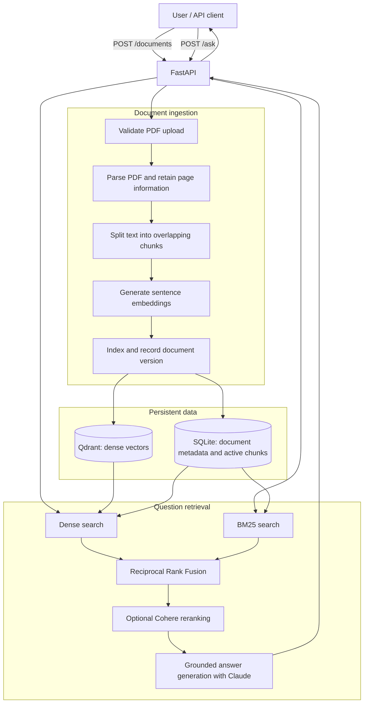
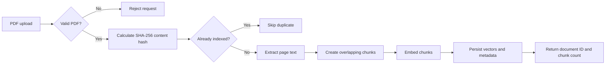
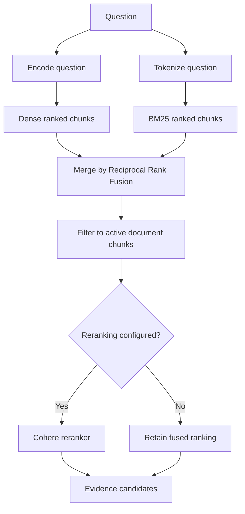
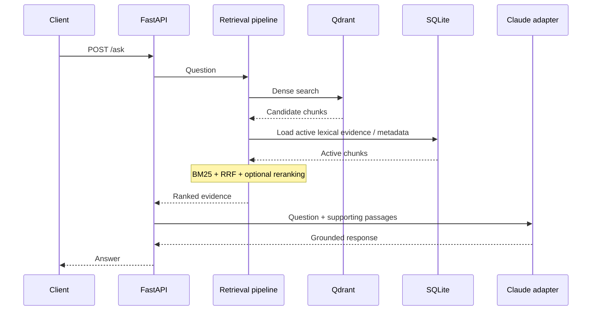
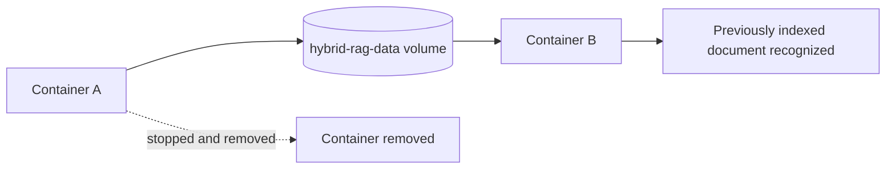

# Hybrid Search RAG

**Evidence-grounded retrieval and question answering over PDF documents.**

A question-answering system has a rather serious obligation: it should be able to explain where its answers came from. A fluent answer is not necessarily a correct one. If the information exists in a document, the system should retrieve the relevant passage, preserve its connection to the source, and use that evidence to answer the question. If the evidence is insufficient, the answer should not pretend otherwise.

This project investigates the engineering problem behind that obligation. It implements a document-ingestion pipeline, two complementary retrieval methods, rank fusion, optional reranking, and grounded answer generation. It also includes persistent storage, an HTTP API, automated tests, a reproducible Docker deployment, and an evaluation harness that compares retrieval methods instead of assuming that a more complicated pipeline must be better.

## 1. The problem

Suppose an employee asks: **“How much paid vacation time do staff get?”**

The relevant document might say: **“Full-time employees receive 25 days of paid annual leave.”**

A simple keyword search might struggle with the mismatch between *vacation time* and *annual leave*. A semantic search model can represent those phrases as related even though they do not share the same words. But semantic similarity introduces a different risk: a passage can sound conceptually related without containing the precise fact the question needs. Exact terminology, numbers, and named policies matter.

The system therefore uses two retrieval signals:

- **Dense retrieval** compares numerical representations of meaning, called *embeddings*.
- **BM25** scores passages according to their lexical overlap with the query, accounting for term frequency, document frequency, and passage length.

Their ranked results are combined with **Reciprocal Rank Fusion (RRF)**. An optional reranking stage can examine the retrieved candidates more closely before evidence is passed to the answer generator.

The central question is not whether dense retrieval or BM25 is universally better. It is whether the system can retrieve the right evidence for a particular question, reliably and measurably.

## 2. Architecture at a glance



This is a logical diagram. The components are application modules inside one Python service; the diagram does not imply that each box is a separately deployed microservice. Qdrant is used in its local persistent configuration in the Docker deployment, and SQLite holds document metadata. The lexical index can be reconstructed from persisted active chunks when the application starts.

### Why these boundaries matter

The API should not need to know how embeddings are calculated. The retrieval pipeline should not need to know how an HTTP multipart upload is parsed. The storage adapters should not decide what constitutes a well-grounded answer. Separating these responsibilities makes it possible to test the retrieval logic without starting a web server, test API validation without calling an external language model, and replace an infrastructure dependency without rewriting the whole application.

The code is organized around **domain**, **application**, **infrastructure**, and **API** layers under `backend/src/hybrid_rag/`.

## 3. From PDF to searchable evidence

A PDF is a file format, not a ready-made collection of meaningful search units. Before a question can be answered, the system must decide which text to extract, how much of it belongs in one retrievable passage, and how to preserve its identity.



### Upload validation

The `/documents` endpoint accepts a PDF as a multipart file upload. The implemented upload path checks the `.pdf` filename suffix, the `%PDF-` file signature, and a **20 MiB maximum upload size**. The upload is streamed through a temporary file rather than assuming the entire input should be held in memory. These checks are useful, but they are not a substitute for authentication, malware scanning, or sandboxed processing in an untrusted public deployment.

### Parsing and chunking

**PyMuPDF** extracts text from PDF pages. The pipeline retains page information so that a retrieved passage can remain connected to the document from which it came. Text is divided into chunks with a configured target of **1,000 characters** and an overlap of **200 characters**.

Why overlap? Imagine a rule begins at the end of one chunk and its exception appears at the beginning of the next. Splitting at that boundary can destroy the relationship between the rule and its qualification. Overlap gives adjacent chunks some shared context. It does not eliminate every boundary problem; it reduces one predictable source of information loss.

Chunk size is a trade-off. Very small chunks can be precise but lack context. Very large chunks can contain the answer alongside a great deal of irrelevant material. The chosen values are implementation settings, not an assertion that they are optimal for every corpus.

### Document and chunk identity

The application calculates a **SHA-256 hash of document content** and uses that value as the document ID. The same bytes produce the same ID. This makes repeated uploads detectable without relying on the filename, which is neither unique nor a reliable indication of file contents.

Chunks also receive deterministic identities. That matters for repeatable indexing and for distinguishing one stored passage from another.

A changed file generally has a different content hash, even if its filename stays the same. Content-based identity should therefore not be confused with a stable business-level identity for a document that evolves over time. The indexing implementation includes version-aware and active-chunk filtering; the public API should still be understood in terms of its actual content-hash behavior.

## 4. Dense retrieval: comparing meaning numerically

A sentence embedding model maps text into a vector: an ordered sequence of numbers. In this project, the model is **`sentence-transformers/all-MiniLM-L6-v2`**, producing **384-dimensional** embeddings.

The numbers are learned representations. A single coordinate does not translate into a neat English concept such as “vacation” or “employment.” Meaning is represented by patterns across the vector.

If the query embedding is \(q\) and a chunk embedding is \(d\), cosine similarity is:

\[
\operatorname{cos}(q,d)=\frac{q\cdot d}{\lVert q\rVert\lVert d\rVert}
\]

The numerator is the dot product. The denominator adjusts for vector lengths. With normalized vectors, cosine similarity can be computed as a dot product. Larger scores indicate greater alignment in embedding space, **not a probability that the passage is correct**.

For our example, a semantic retriever may recognize that “paid vacation time” is related to “paid annual leave.” It can recover a relevant passage despite different wording. But the same capacity for generalization can retrieve plausible-looking passages that fail to answer the question precisely.

**Qdrant** stores and searches the chunk vectors. The Docker configuration persists its local data under `/app/data/qdrant_storage`.

## 5. BM25: taking the actual words seriously

BM25 is a lexical ranking method. It rewards query terms that occur in a passage, while adjusting for how common those terms are across the corpus and how long the passage is.

A standard BM25 formulation is:

\[
\operatorname{BM25}(q,d)=\sum_{t\in q}\operatorname{IDF}(t)
\frac{f(t,d)(k_1+1)}{f(t,d)+k_1\left(1-b+b\frac{|d|}{\operatorname{avgdl}}\right)}
\]

Here:

- \(f(t,d)\) is the frequency of term \(t\) in passage \(d\).
- \(\operatorname{IDF}(t)\) reflects how informative the term is across the collection.
- \(|d|\) is the passage length, and \(\operatorname{avgdl}\) is the average passage length.
- \(k_1\) and \(b\) control term-frequency saturation and length normalization.

A term appearing repeatedly should matter, but it should not make the score grow without limit. A rare, discriminative term should generally contribute more than a term that appears in almost every document.

BM25 is useful for precise policy names, uncommon terminology, and questions where the exact words matter. Its limitation is equally important: if a query and a relevant passage use different vocabulary, lexical matching may miss their relationship.

The application uses **`rank-bm25`** for lexical retrieval. Its in-memory lexical state is recoverable from persisted active chunks, so a container restart does not require the original PDF to be uploaded again simply to rebuild BM25 search.

## 6. Hybrid retrieval and Reciprocal Rank Fusion

Dense and lexical retrievers produce different kinds of scores. A cosine similarity score and a BM25 score are not directly comparable: they come from different mathematical models and do not share a meaningful common scale.

RRF avoids comparing those raw values. It combines **ranks**.

\[
\operatorname{RRF}(d)=\sum_{r\in\mathcal R}\frac{1}{k+\operatorname{rank}_r(d)}
\]

\(\mathcal R\) is the set of ranked result lists. \(\operatorname{rank}_r(d)\) is the position of document or chunk \(d\) in list \(r\). The constant \(k\) reduces the effect of very high individual ranks; it is a fusion parameter, not the number of requested results.

Consider two candidate passages and a hypothetical \(k=60\):

| Passage | Dense rank | BM25 rank | RRF contribution |
|---|---:|---:|---:|
| A | 1 | 4 | \(1/61+1/64\approx0.0320\) |
| B | 3 | 1 | \(1/63+1/61\approx0.0323\) |

Passage B wins narrowly because it performs well across both lists. This example illustrates the formula; it is not a claim about the exact rankings or fusion parameter used in a particular run of this project.



Fusion increases the range of ways a relevant passage might be discovered. It does **not** guarantee that hybrid search beats either component. If one retriever already ranks the correct passage first, combining it with a noisier list can move that passage down.

### Version-aware filtering

A retrieval result is only useful if it refers to an active chunk. A stale vector from a superseded document version can be semantically relevant and still be the wrong evidence to present. The application includes active-version filtering for both dense and lexical retrieval, with metadata maintained in SQLite. This is an integrity concern, not merely a ranking concern.

## 7. Reranking and grounded answer generation

The first retrieval pass must search a potentially large collection efficiently. A reranker has a different job: examine a smaller set of candidate passages more closely and reorder them according to their relevance to the particular question.

The project implements an **optional Cohere reranking adapter**. The external service is not required to understand or test the core dense/BM25/RRF retrieval logic.

The grounded generation layer uses an **Anthropic Claude adapter**. The retrieved passages provide the evidence from which the answer is constructed. The purpose of grounding is to constrain the answer to information the system has found in the documents and to make the supporting material available to the application.

Grounding is a design objective, not a mathematical guarantee against hallucinations. An LLM can still misread a passage, omit a qualification, or express more certainty than the evidence warrants. The answer-generation implementation and its tests should be distinguished from an independently verified live API call to the external model.



This diagram describes the logical request flow. Some calls are orchestrated through application services rather than directly from the API handler.

## 8. Persistence and recovery

An index that disappears whenever the server restarts is useful for a demonstration, but not for a document service. The Docker image therefore separates disposable application processes from durable application data.

The container stores its persistent state under `/app/data`, mounted to the named Docker volume `hybrid-rag-data`:

- `/app/data/qdrant_storage` — local Qdrant vector data.
- `/app/data/documents.db` — SQLite document metadata.
- `/app/data/huggingface` — downloaded model files, reducing repeated downloads.



### What was actually verified

We uploaded a generated test PDF, then uploaded the identical bytes again. The first response returned `action: "create"`; the second returned `action: "skip"`. Both used the same SHA-256 document ID and reported one chunk.

We then **stopped and removed the container**, recreated it using the **same named volume**, confirmed `GET /health` returned HTTP 200, and uploaded the identical PDF once more. The application again returned `action: "skip"` with the original ID. This demonstrates that the persisted ingestion record was recovered after container recreation.

That is not, by itself, an independent post-restart measurement of vector-search quality. The test suite includes persistent-retrieval integration tests; a live retrieval smoke test after container recreation remains a useful final check.

## 9. HTTP API

The application exposes these endpoints:

| Endpoint | Purpose | Verification |
|---|---|---|
| `GET /health` | Check application health | Live Docker response: HTTP 200, `{"status":"healthy"}` |
| `POST /documents` | Upload and index a PDF | Live Docker responses: `create`, then `skip` |
| `POST /ask` | Ask a question against retrieved document evidence | Implemented and covered by automated tests; live external-model invocation not independently verified |

### Upload a PDF

```bash
curl -i -X POST http://127.0.0.1:8000/documents \
  -F "file=@path/to/document.pdf"
```

A verified first-upload response from the Docker test was:

```json
{
  "document_id": "915f8fd4d1fd44decb5da78a0f6b41095f2b3a25ba9f0a4693c3d98b86ee67c8",
  "filename": "docker-test-policy.pdf",
  "chunk_count": 1,
  "action": "create"
}
```

Uploading the same bytes again produced `"action": "skip"`. The observed endpoint returned HTTP **201 Created** in both cases, so clients should inspect the response's `action` field rather than infer indexing behavior from the status code alone.

### Explore the request schemas

Start the API and open **`http://127.0.0.1:8000/docs`** for FastAPI's interactive OpenAPI documentation. This is the authoritative place to inspect the current `/ask` request and response fields without relying on an invented example payload.

## 10. Installation and local development

**Requirements:** Python 3.12, Git, and sufficient disk space for the embedding model and ML dependencies.

```bash
# Clone the repository
git clone https://github.com/nourelashryy199/hybrid-search-rag.git
cd hybrid-search-rag

# Create and activate a virtual environment
python3.12 -m venv .venv
source .venv/bin/activate

# Install the application and development dependencies
python -m pip install --upgrade pip
python -m pip install -e ".[dev]"

# Check dependency compatibility
python -m pip check

# Run tests
python -m pytest -q
```

The API can be started with:

```bash
python -m uvicorn hybrid_rag.api.main:app --host 127.0.0.1 --port 8000
```

Then check:

```bash
curl http://127.0.0.1:8000/health
```

Expected response:

```json
{"status":"healthy"}
```

The first startup may take longer because the sentence embedding model must be downloaded. External answer generation requires appropriate API credentials; do not commit credentials to Git.

## 11. Docker deployment

The Dockerfile uses **Python 3.12 slim**, installs the required Python packages, runs the application as a non-root user, and starts Uvicorn on port 8000. The Docker configuration also accounts for a dependency compatibility issue encountered during development: the tested Linux ARM64 image used **PyTorch 2.5.1**, **Transformers 4.57.6**, and **Sentence Transformers 5.7.0**.

```bash
# Build
docker build -t hybrid-search-rag:local .

# Create persistent storage
docker volume create hybrid-rag-data

# Run the API
docker run -d \
  --name hybrid-rag-api \
  -p 127.0.0.1:8000:8000 \
  -v hybrid-rag-data:/app/data \
  hybrid-search-rag:local

# Verify startup and health
docker logs hybrid-rag-api
curl http://127.0.0.1:8000/health
```

The port is bound to **localhost**, not exposed to the public internet. This matters because the document-upload endpoint is not protected by an authentication system.

To recreate the container **without deleting the indexed data**:

```bash
docker stop hybrid-rag-api
docker rm hybrid-rag-api

docker run -d \
  --name hybrid-rag-api \
  -p 127.0.0.1:8000:8000 \
  -v hybrid-rag-data:/app/data \
  hybrid-search-rag:local
```

Do not delete `hybrid-rag-data` if you want to retain its stored state. Embedded Qdrant should not be treated as a multi-instance shared database: do not run several application instances concurrently against the same local storage directory.

## 12. Evaluating retrieval instead of trusting intuition

A system can produce a convincing answer while retrieving the wrong passage. Evaluation therefore begins **before** answer generation. We need to ask whether the correct evidence was retrieved, and where it appeared in the ranking.

The project includes a small synthetic policy corpus and **12 evaluation queries**, with scripts under `evaluation/` for running retrieval experiments and inspecting rankings.

### Recall@k

Recall@k measures how much of the relevant evidence appears among the first \(k\) retrieved results. In a dataset with one relevant passage per query, it becomes the fraction of questions for which the correct passage appears within the top \(k\).

\[
\operatorname{Recall@k}=\frac{1}{|Q|}\sum_{q\in Q}
\frac{|\operatorname{Relevant}(q)\cap\operatorname{TopK}(q)|}{|\operatorname{Relevant}(q)|}
\]

### Mean Reciprocal Rank (MRR)

MRR rewards finding the **first relevant result early**. If the first relevant passage appears at rank 1, the reciprocal rank is 1. At rank 2, it is 1/2. At rank 5, it is 1/5.

\[
\operatorname{MRR}=\frac{1}{|Q|}\sum_{q\in Q}\frac{1}{\operatorname{rank}_{q,\mathrm{first\ relevant}}}
\]

Queries with no retrieved relevant result contribute zero.

### Recorded results

| Method | Recall@1 | Recall@3 | MRR |
|---|---:|---:|---:|
| Dense | 0.667 | 1.000 | 0.833 |
| BM25 | **0.833** | 1.000 | **0.903** |
| Hybrid (RRF) | 0.750 | 1.000 | 0.875 |

**BM25 performed best on this benchmark.** All three approaches found the relevant passage within their top three results for the evaluated queries, but BM25 more frequently ranked it first.

That result deserves an explanation. A small, synthetic policy corpus may contain repeated wording and highly discriminative terms. Under those conditions, lexical matching can be extremely effective. Dense retrieval can recover paraphrases, but that advantage does not necessarily translate into a better first-place ranking on every dataset. Fusion can also disturb a strong ranking when it incorporates a weaker one.

Twelve queries are not enough to establish general superiority. These results are a **baseline**, not a universal claim about enterprise retrieval. A more comprehensive study would test larger and more diverse corpora, realistic user paraphrases, ambiguous questions, multiple relevant passages, document updates, and queries with no answer in the collection.

## 13. Testing and continuous integration

The repository includes unit and integration tests for the API, indexing, persistence, retrieval, reranking, grounded generation, and evaluation logic. The latest verified local run reported:

```text
325 passed, 5 warnings in 4.69s
```

The five warnings were nonfatal deprecation warnings from dependencies. A GitHub Actions workflow in `.github/workflows/ci.yml` installs the project, runs `pip check`, and executes `pytest` on a Python 3.12 Linux ARM64 runner.

**GitHub Actions CI run #2 passed** on commit `36b4cd2` after a workflow YAML correction. This verifies that the test suite can run in a fresh CI environment, not only in the developer's local virtual environment.

The CI workflow does not, by itself, prove that live Anthropic or Cohere credentials work, that all third-party services are available, or that retrieval accuracy generalizes to unseen document collections.

## 14. Repository layout

```text
hybrid-search-rag/
├── backend/
│   ├── src/hybrid_rag/
│   │   ├── api/              # HTTP routes, schemas and app startup
│   │   ├── application/      # Indexing, retrieval, RAG and evaluation
│   │   ├── domain/           # Core interfaces and domain concepts
│   │   └── infrastructure/   # Qdrant, SQLite, models and API adapters
│   └── tests/               # Unit and integration tests
├── evaluation/              # Evaluation corpus, queries and scripts
├── scripts/                 # Local search and connection smoke tests
├── data/                    # Local generated data (ignored where needed)
├── .github/workflows/ci.yml
├── .dockerignore
├── .gitignore
├── Dockerfile
└── pyproject.toml
```

## 15. Known limitations and engineering trade-offs

**No authentication on document upload.** The API is suitable for local development and controlled demonstrations. Publishing it on the internet without authentication, authorization, upload controls, and appropriate operational safeguards would be unsafe.

**No OCR pipeline.** PyMuPDF extracts available text. Image-only or scanned PDFs may require optical character recognition before they can be searched reliably.

**Embedded Qdrant is single-process-oriented.** Local persistent storage simplifies development and deployment but should not be mistaken for a distributed, multi-writer production database.

**Indexing spans multiple storage components.** Keeping vector data, document metadata, and lexical retrieval state synchronized is a real engineering challenge. The application includes synchronized indexing and recovery mechanisms, but the arrangement is not a single ACID transaction across Qdrant, SQLite, and BM25.

**Content hashes identify bytes, not logical documents.** Editing a PDF changes its hash. Stable identities for evolving organizational documents would require an explicit document identity and version-management policy.

**External generation depends on credentials and service availability.** The core retrieval system can be tested independently, but live Claude answers and optional Cohere reranking require their respective integrations to be configured.

**Evaluation coverage is deliberately limited.** The benchmark is useful for comparing retrieval approaches under known conditions. It does not establish performance on large, noisy, multilingual, scanned, adversarial, or rapidly changing document collections.

**A grounded answer can still be wrong.** Retrieving evidence improves the basis for an answer. It does not eliminate interpretation errors or guarantee that the generator faithfully uses every qualification in the source.

## 16. What this project demonstrates

The difficult part of a retrieval-augmented generation system is not calling an embedding model or sending a prompt to an LLM. It is preserving the relationship between a user's question, the evidence selected to answer it, and the documents from which that evidence originated.

This project approaches that problem as a complete software system. It makes retrieval strategies comparable, gives indexed documents durable identities, separates application logic from infrastructure, tests failure-prone boundaries, and records what the evaluation actually found. The result is a working foundation for evidence-grounded question answering, together with a clear account of what has been verified and what remains uncertain.

---

**Project status:** Portfolio-ready v1 implementation. Local tests and GitHub Actions CI pass; Docker health, PDF ingestion, duplicate detection, and persistence of document records after container recreation have been verified. Live external-model answer generation and independent post-restart vector retrieval remain additional smoke checks.
